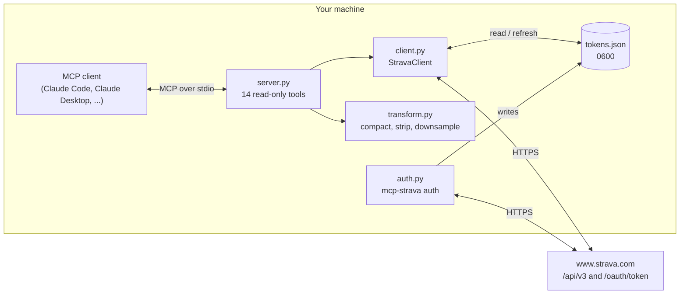
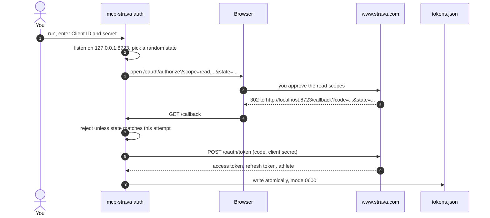
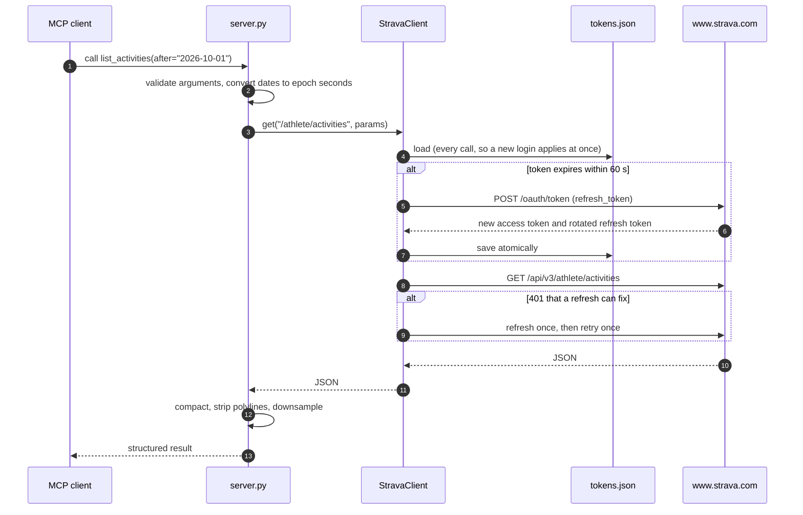

# Architecture

`mcp-strava` is a small, single-user process: an MCP client starts it, talks to it over stdio, and it
turns tool calls into read-only Strava API requests. This page explains how the parts fit and why they
are built the way they are.

## Components

| Module | Responsibility |
| --- | --- |
| `server.py` | Declares the tools, their argument schemas and descriptions; validates arguments; shapes results. Also the command-line entry point. |
| `client.py` | `StravaClient`: adds the bearer token, refreshes it when it is about to expire or is rejected, and turns HTTP failures into errors the model can read. |
| `auth.py` | The one-time OAuth authorization-code flow behind `mcp-strava auth`. |
| `tokens.py` | `TokenStore`: loads and atomically saves the token file. |
| `transform.py` | Pure functions that shrink Strava responses to fit a model's context window. |

## Signing in

A redirect whose `state` belongs to an earlier attempt (for example a reloaded tab) gets a `400` and
the listener keeps waiting for the right one. Each connection's reads are bounded by the time left
before `--timeout`, so a client that connects and stays silent cannot keep the command waiting forever.

## Serving a tool call

## Design decisions

**Local stdio process, not a hosted service.** Strava's API Agreement only allows a user's data to be
shown to that user, and a new API application is limited to one athlete. Running on the athlete's own
machine with their own application fits both rules, keeps tokens off any server, and means the MCP
client configuration holds no secrets.

**A token file rather than environment variables or the OS keychain.** Strava can hand back a new
refresh token on any refresh and retire the old one, so the latest one has to be written back somewhere
the next run can read. A
file works the same on every platform and every MCP client. It is written to a temporary file in the
same directory and swapped in with `os.replace`, so a crash never leaves a half-written file, and
`mkstemp` creates it as `0600` so it is never readable by other users, even briefly.

**One lock around token refresh.** Tool calls can arrive concurrently. The lock ensures one refresh
at a time, so a rotated refresh token is never spent twice. A request that gets a `401` passes the
rejected token back as `stale`, so concurrent `401`s cause one refresh, not several.

**Refresh on `401` only when it can help.** A `401` that names a missing permission (for example
`activity:read_permission`) cannot be fixed by a new token, so it fails at once with instructions
instead of spending two more requests of the rate limit.

**Errors are `ToolError`s.** The MCP SDK hides the text of any other exception from the client. Strava
failures, network failures and an unreadable token file are raised as `StravaError` (a `ToolError`
subclass), so the model sees what went wrong and what to do about it.

**Responses are shaped for a model.** Encoded polylines are long and meaningless to a model, so they
are removed. Activity lists keep the fields worth reading and add kilometres, miles and `h:mm:ss`.
Streams can hold tens of thousands of points per channel, so they are evenly sampled down to 500 by
default, always keeping the first and last point, so every channel stays aligned.

**Model-supplied arguments are typed or validated.** Activity and segment IDs are integers in the tool
schema, and gear IDs must be alphanumeric, so no argument can add path segments or query parameters to
a Strava URL.

## Non-goals

- **Writing to Strava.** No uploads, edits, kudos or comments. This is the core safety property.
- **Several athletes per installation.** One token file, one athlete.
- **Webhooks or background sync.** The server only acts when a tool is called.
